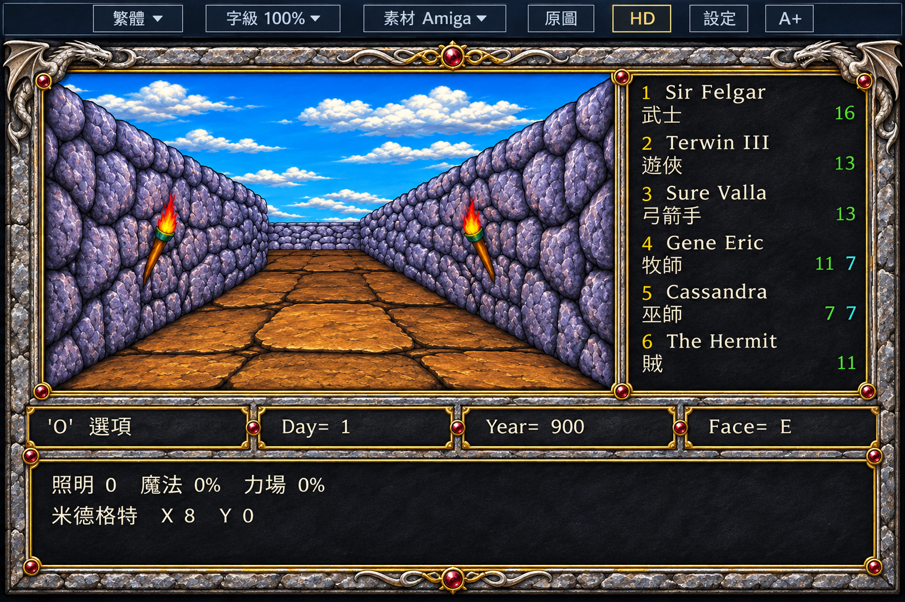

# Amiga HD、工具列與簡體中文

狀態：CONFORMED。2026-11-11 使用者確認下方定稿並授權實作，本規格的顯示功能已通過下列驗證。工作紀錄見 [WORKLOG](../../WORKLOG.md)，目前狀態入口為 [CONTEXT §1.5](../../CONTEXT.md)。本狀態不外推為整款遊戲的原版 parity。

2026-11-12 字高修正契約：工具列英文採同一 Noto Sans 的等高大寫字模，英數字的可見高度對齊中文；24／30／36 px 三種字集均適用。長標籤只壓縮水平尺寸，不連帶縮小高度。正文保留既有大小寫、共同基線與小寫字母降部，中文字模、按鈕及命中區不變。單獨重烘使用 `tools/build_display_locales.py --toolbar-only --latin-fonts <Noto 字型目錄>`，輸出為 `assets/font/toolbar-sans{24,30,36}.bin`。本修正狀態為 CONFORMED，字模、原生工具列渲染、正常 GUI 及新版成片均已驗證；[字高對照圖](../../dist-all/v.1.2.1-20261112/smoke/toolbar/before-after.png)與測試收據保存於該版 `smoke/`。

README 的 HD 展示總覽及完整 930 筆圖集由 `tools/render_hd_overview.py` 直接排列實際圖包產生，不生成新美術；檔案位於 `docs/gallery/amiga-hd-overview.webp` 與 `amiga-hd-complete.webp`。

## 已確認的範圍

- 工具列參考 `/home/anr2/cht/mm3/mm3display/display_toolbar.go` 的頂端浮出操作。提供繁簡中文、遊戲字級、素材來源、原圖／HD、設定及工具列字級。
- HD 採 Amiga 原圖的手繪重製風格。邊框採定稿的石雕、古銀、細金線、紅寶石及雙龍角飾，材質參考 mm3 與 `/home/anr2/cht/mm45/docs/images/gameplay-town-hd.webp`。
- 原圖可切回。HD 不改 DOS 規則、地圖、事件與亂數；原圖模式保留 DOS 動畫。HD 片頭編排及使用者另行確認的 Unicode 存檔擴充見下方。mm3 的模擬器 CPU／cycles 控制不適用本案 Go remake。
- 顯示設定另存使用者設定目錄；切換語言不重開遊戲，不改已持有的事件、角色與物品識別值。

## 證據與界線

| 項目 | 等級與來源 |
|---|---|
| 定稿 | 已確認。對話中先選手繪重製，再要求參考 mm3／mm45 重設 HD 邊框，最後確認本圖並授權開工。圖由內建 imagegen 產生，保留完整原檔。 |
| 素材幾何 | 已證實於目前程式。`internal/view/firstperson.go` 的落點表、`internal/assets/amiga` 與 `tools/amiga32.py`；原版檔案 SHA-256 見 `docs/inventory.md`。本規格不新增原版行為推論。 |
| 原圖渲染 | 沿用 `internal/view`、`internal/render`。原邏輯畫布 320×200，高解析畫布 960×600。 |
| 怪物來源 | 本機 `workplace/amiga-monsters/set.json` 共 72 組、530 幀，包含未對應 DOS 槽的額外圖。以 manifest 的 slot、frames、anim 為準。 |
| 簡中 | 顯示層轉換。現有 `translations/zh-Hant.json` 的 key、src_sha8 與繁中譯文維持；OpenCC 0.1.7 只產生另存的簡中資料與顯示對照，不覆寫已驗收繁中。來源、鎖版雜湊、授權及字型在生成收據記錄。 |
| HD 忠實度 | 刻意的美術重製，不宣稱原版逐像素一致。來源位置、透明區與播放次序仍由原資料控制。 |

## 顯示契約

- 遊戲畫布為 960×600，工具列位於其上方獨立一列，預設高 40 像素，與定稿的 960×640 比例相同。收起控制項時保留該列，不遮擋第一位隊員與 HD 邊框。視窗縮放使用同一轉換處理繪製與點擊。移到頂端顯示，離開工具列且選單關閉時隱藏。點擊與拖出後的放開都由工具列持有；Esc 先關工具列選單。
- 新工具列文字以穩定 key 從 UTF-8 `translations/interface.tsv` 讀取。既有 JSON 譯文流程保留。
- 繁簡轉換只接在文字繪製出口。輸入、條件比對、檔案名稱及存檔不經轉換。繁中與簡中分別驗字集；英文姓名與 `%d`、`@` 等格式及控制碼保留。
- 遊戲字級提供 80%、90%、100%，保留原欄寬與行距；工具列自身另提供 100%、125%、150%。文字以同一命中矩形置中，限制寬高，長標籤顯示省略符。
- HD 與素材來源分開保存。啟用 HD 使用 Amiga 美術，切到其他平台時使用其原圖。未載到完整且相容的 HD 包時，明示不可用並保留原圖。
- HD 圖包以來源檔 SHA-256、原圖編號、原尺寸、目標尺寸及輸出 SHA-256 對位。RGBA 美術不塞回原版索引色；透明區由原圖遮罩控制。尺寸、索引、路徑或雜湊錯誤須拒絕整包，不能半套啟用。
- 邊框由定稿拆分成不含文字與遊戲場景的圖層。實際畫面在定稿的開口內合成，文字與數字來自目前遊戲狀態，不能以定稿上的假資料代替。

## 驗收

| 面向 | 最小充分驗證 |
|---|---|
| 工具列 | 點擊語系、素材、原圖／HD、設定；縮放後命中區、拖出放開、選單 Esc、三種工具列字級。 |
| 繁簡 | 同狀態的探索、設施、角色／物品、訊息及戰鬥；字集覆蓋、格式／控制碼不變、切換前後遊戲存檔 bytes 相同。 |
| HD | 定稿與實際邊框對照；場景轉向、遮擋、火炬、怪物動畫；原圖→HD→原圖恢復相同畫面。缺圖／錯圖包反向測試。 |
| 正常路徑 | 從新局走到設施、離開、移動、存檔、離開並重載。沿用現有戰鬥 fixture 抽測一般與快速戰鬥。 |
| 工程 | Go 全套測試、建置、目前私有工作 repo 情境的 release 檢查、工作樹及容器清理。 |

原始資料與完整 HD 包留 `workplace/hd-amiga-r1/`，不含新的公開、推送或 Release 授權。現有正式產物不覆寫。

## 本次驗證結果

| 面向 | 結果與收據 |
|---|---|
| 工具列與繁簡 | 通過鍵值、原文雜湊、格式／控制碼及字集覆蓋檢查；工具列命中、拖出放開、Esc 與 100%／125%／150% 字型測試通過。繁簡與 80%／90%／100% 字級只影響顯示。 |
| 既有字型 | 2,244 個舊字形逐字位元相同，只補入原本缺少的 U+2190 左箭頭。新增繁簡顯示字型各含 2,986 字，與原版點陣字型分開。 |
| HD 圖包 | 400 張場景圖、530 幀怪物圖，共 930 筆，913 張獨立成品。73 張生成拼圖全部完成；來源雜湊、成品雜湊與三倍原尺寸逐項通過。`asset-audit.json`、`hd.json` 與生成母圖留在本機圖包。 |
| 可重現處理 | 從保存的母圖執行 `tools/prepare_hd_amiga.py repack`，930 筆成品雜湊全部相同，收據為 `repack-check.json`。圖像生成本身不保證逐次相同；可重現的是母圖後的切分、定位及縮放。 |
| 載入與回復 | 完整圖包實際載入；缺圖、來源不完整、錯誤來源／成品雜湊、越界路徑與尺寸不符的反向測試通過。原圖→HD→原圖後畫面雜湊相同，顯示切換前後存檔資料相同。 |
| 戰鬥 | 固定種子 `0x1234`，以相同初始 fixture、動畫呼叫與操作比較原圖／HD。一般與快速戰鬥的狀態、寶箱及模式相同。這是 remake 顯示隔離測試，沒有新增 DOS oracle 聲明。 |
| 正常玩家路徑 | 封裝目錄的執行檔及字型，在原圖／HD 各走一輪新局、轉向、繁簡、設定、物品、商店、步行進神殿再離開、字級調整、存檔、離開及重載。存檔 JSON 完全相同；GUI 收據見本機 `gui-hd-r3/` 與 `gui-original-final/`。 |
| 工程 | `go test ./...`、`go vet ./...`、Linux 建置、public 舞台目錄資源 allow-list、目前私有工作 repo 的 `tools/check_release.sh` 均通過。最後一組美術更新後另跑顯示與雙戰鬥抽測。 |

實機截圖與日誌位於 `workplace/hd-amiga-r1/`，包含 `showcase-left.png`、`gui-hd-r3/13-temple.png`、`battle-normal-hans.png` 及 `go-test-final.log`。已檢視探索、轉向、火炬、設定、商店、神殿與怪物畫面；天花板的原版抖色改成石砌材質，火炬圖層使用透明背景。

HD 接入既有第一人稱、怪物及片頭播放路徑。片頭採 Amiga 構圖，十一個來源姿勢對應至重製動作；嘴部與尾巴用局部連續形變避免接縫，眼睛及樹間人物用重繪疊圖。位置由原始底圖共同像素推定，編排以既有 DOS 動作序列為基礎，不宣稱 Amiga 原版時序對拍。原圖模式保留 DOS 片頭，世界地圖沿用已驗收掃描圖。`book` 等未使用素材只保留索引；`globe.32` 不屬於現有解析器支援容器，未列入 930 筆覆蓋分母。三平台完整包與影片見 [交付規格](hd-full-release.md)。

本輪只驗 Linux 容器，沒有重新發行或驗收 Windows／macOS 真機。手繪素材是刻意的視覺重製，原版動畫用途等既有未知仍依 `CONTEXT.md` 的證據等級保留。

## 簡體輸入擴充

狀態：CONFORMED。使用者於 2026-11-11 明確選擇完整支援姓名與繁簡答案，包含相容舊檔的 Unicode 名冊資料。此節已通過下列範圍的驗證。

- 姓名保留玩家輸入的繁簡原字，最多十字；編輯按 Unicode 字元處理。輸入法組字尚未確認時不送出姓名或答案，Enter 先供輸入法選字。繁簡切換不改姓名原值。
- 使用目前鎖定的 Ebiten 2.9.9 `exp/textinput.Field` 處理原生輸入法。Windows／macOS 使用其原生組字介面；Linux 沿用 GLFW XIM 提交字元路徑，不自製輸入法。平台真機驗證分開記錄。
- Linux 實測發現 GLFW 會把已由 XIM 消耗的 Enter 等編輯鍵仍回報給遊戲。相依來源以 Go vendor 保存，對鎖定版本增加局部修補：已消耗的 Enter、Esc、Backspace、Delete 不再重複送到遊戲。未消耗按鍵與原版規則維持；修補工具驗證來源 SHA-256，不改共享模組快取。
- 新增獨立輸入字型，覆蓋字型實際支援的中日韓統一表意文字及擴展 A。沿用現有字型、排版與工具列，不重製已驗收字形。
- 謎題以獨立 UTF-8 TSV 列出原版答案識別值、語系與輸入別名。沿用已驗收譯名「米努」「鑰匙／钥匙」「德魯伊／德鲁伊」，並接受四道數字題的中文數字。別名只在送出目前題目時轉回原版英數值，遊戲層的答案比對不讀顯示譯文。全形英數在輸入邊界轉成半形；控制室的動態字母密碼維持所顯示的代碼。
- 原版解析器繼續拒絕無效 ASCII 姓名槽；原生建立的 Unicode 姓名不再被當成空槽。姓名判斷、原版解析與 UI 字型驗證分開。
- 存檔升為第 3 版，在既有 JSON 加入隊伍及名冊快照，包含完整 UTF-8 姓名與 130-byte 原版記錄。第 1／2 版繼續可讀。原版 ROSTER.DAT 的大小與記錄格式不改，無法用 ASCII 表達的姓名使用相容代名，完整姓名以 JSON 為準。未知原版記錄 bytes 原樣保存。
- 驗收：Unicode 姓名建立→名冊→編組→存檔→全新行程重載，包含十字與退格；繁簡／全形／錯誤答案→同一既有事件分支；字型覆蓋、組字確認不誤提交、舊檔及破損新檔；全套測試與正常 GUI 截圖。不新增原版精確對拍聲明。

| 驗證 | 結果與本機收據 |
|---|---|
| 中文姓名 | 正常 UI 建角、繁簡字元、十字上限、退格、編組、完整角色與名冊重載通過。原版欄位、學法術及物品增減後姓名不變；原版無效槽與未知 bytes 往返通過。 |
| 繁簡答案 | `translations/input-aliases.tsv` 七組識別值完整；繁簡、全形、錯誤與跨題答案檢查通過。使用既有 KEYS 事件的 UI 續跑驗證，繁簡都進入相同分支，錯誤答案仍失敗。 |
| 輸入字型 | 繁簡各 29,246 字，來源、範圍及成品 SHA-256 見 `translations/input-font-build.json`。固定介面字型保持既有圖形，缺字時才使用輸入字型。舊字型檢查排除測試 fixture 與 vendor，輸入字集另由實際輸入測試驗證。 |
| 真實輸入法 | `tools/check_input_gui.sh` 使用 IBus 1.5.27、libpinyin 1.15.1，在正常建角畫面實際輸入 `测试long`。組字 Esc、退格、Enter 均不影響已提交字元或提前送出；以全新行程重載後 JSON 相同。收據 `gui-input-edit-final/checks.json`，畫面 `04-ime-confirm.png`。 |
| Linux 修補 | 原始 `x11_window_linbsd.c` SHA-256 為 `eaba4f2e10664d997a32386f1dfdf79adbce5b2c51e57b2f466ef2d334c00270`；修補後為 `149f76078c8b284afab13c8706d59b2d2243d5e888172f80ac6e375a9228d623`。保留未消耗按鍵後續轉送與去重，未改共享快取。 |
| 工程 | 完整 `go test ./...` 通過，UI 95.659 秒；`go vet ./...` 通過。Linux 與 Windows x64 編譯成功。完整日誌 `input-go-test-final.log`、`input-go-vet.log`。 |
| 封裝與正常操作 | `package-input-final/` 舞台資源 allow-list 通過；使用舞台執行檔與資源完成繁簡、原圖／HD、設定、物品、商店、神殿進出、字級與存讀檔，收據 `gui-input-normal-r2/checks.json`。私有工作 repo 釋出檢查通過，沒有重新發行。 |

實機操作另修正既有 `N` 鍵的拒絕／建角分派衝突，包含前端回歸測試。輸入法驗收只涵蓋 Linux X11／IBus；Windows 已編譯，Windows／macOS 原生輸入法尚未真機驗證。輸入字型未涵蓋的字會明示拒絕，不能把本字集稱作所有 Unicode 字形。
