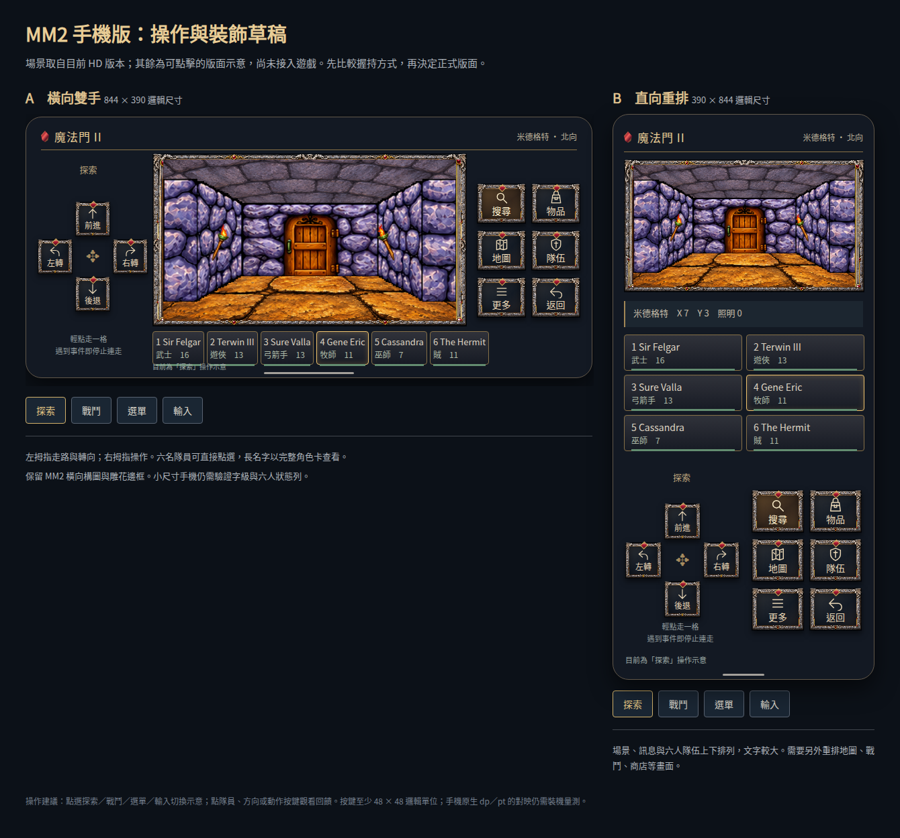

# MM2 Android 手機版定稿與開發計畫

範圍與視覺已定稿。原生操作、中文輸入與安全檢查點切片已完成下列本機驗收。
定稿參考、原生實作與本機 APK 已接通；實際驗收範圍另記於目前狀態表。

## 已確認決定

使用者於 2026-11-11 回覆「ok 定稿」，接受建議的 A 款橫向雙手操作，隨後明確指定「android 版本就好囉」。

| 項目 | 定稿 |
|---|---|
| 平台 | 只做 Android。iPhone／iOS 不列入開發範圍。 |
| 方向 | A 款橫向雙手操作，參考邏輯尺寸 844×390。B 款直向版不採用。 |
| 操作 | 左拇指控制前進、後退與轉向；右拇指操作當前指令。六名隊員可直接點選。 |
| 視覺 | 沿用 MM2 HD 的雕花古銀框、細金線、紅寶石與深色底，搭配圖示及中文標籤。按下、選取與停用狀態須可辨識。 |
| 文字 | 保留繁簡顯示與中文輸入。姓名保留輸入原字，沿用既有謎題別名。 |

## 定稿參考

下圖左側 A 是定稿。右側 B 僅保留原始比較紀錄，不代表另一條開發分支。

- [可點擊的原始操作草稿](assets/android-mobile-r1/index.html)
- [戰鬥與輸入情境示意](assets/android-mobile-r1/context-controls.png)
- [決定、來源及檔案 SHA-256](assets/android-mobile-r1/approval.json)
- [瀏覽器草稿檢查收據](assets/android-mobile-r1/checks.json)

以上檔案從使用者看過的草稿原樣保存，圖像與 HTML 的位元組不變。構圖、比例、配色、字型、裝飾及元件位置以原圖與 HTML 的 A 款為準。實作以同畫面狀態對照；若安全區、字級或平台限制使定稿無法照做，先展示差異，再確認調整。

草稿的按鍵至少為 48×48 邏輯單位。正式 Android 版須量測至少 48×48dp 的點擊範圍，不能直接把遊戲像素當作 dp；依據 [Android 觸控指引](https://developer.android.com/guide/topics/ui/accessibility/apps#touch-targets)。

## 操作契約

| 情境 | 玩家操作與預期結果 |
|---|---|
| 探索 | 輕點方向鍵走一格或轉向。連走遇到事件、選單、戰鬥、輸入或失去觸控時停止；重複輸入的時序在 Android 操作原型中量測。 |
| 隊員 | 點六人狀態列選取隊員，展開完整姓名、資料與既有指令。施法沿用目前施法者選單與目標流程。 |
| 戰鬥 | 右側改顯示攻擊、施法、抵擋、物品等當前可用指令。移動鍵停用，目標與隊員可直接點選。 |
| 選單與設施 | 以大點擊區選取項目；返回沿用取消語意。選取、確認及執行的次序沿用目前互動層。 |
| 文字輸入 | 使用系統輸入法，組字確認與送出分開。鍵盤彈出後仍可看見輸入欄與確認、取消；繁簡姓名及謎題答案都需實測。 |
| 更多與設定 | 收納存檔、說明、繁簡、原圖／HD等既有功能，保留其目前可用狀態與存檔閘門。 |

觸控層轉成既有語意動作，遊戲規則與存檔相容性沿用目前實作。多指、拖出、取消、長按停止與重複派送須在原生觸控原型驗證後寫成 READY 契約。瀏覽器的點擊回饋不等於遊戲動作已接通。

## 現有證據與平台缺口

| 等級 | 證據與意義 |
|---|---|
| 已證實 | `cmd/mm2/main.go` 的 `keymap`、`arrows` 與 `dispatchKey` 將實體鍵轉成 `ui.Key`；桌面畫布由 `Draw`／`Layout` 等比例配置。 |
| 已證實 | 桌面工具列的指標入口仍在 `internal/ui/toolbar.go`。手機另由 `internal/mobileui` 提供指令、選單、隊員及閱讀分頁，經 `mobile/mobile.go` 接入原生觸控。 |
| 已證實 | 鎖定的 Ebiten 2.9.9 在 `exp/textinput/textinput_noime.go` 對 Android 使用無 IME 的字元輸入替代實作。不能沿用 Linux 輸入驗收來宣稱手機中文輸入已完成。 |
| 已證實 | 草稿的 A／B 各 16 個主要點擊區均通過大小檢查；隊員選取、返回、戰鬥按鍵與 Unicode 輸入預覽通過瀏覽器檢查。只採用 A。 |
| 實作已接通 | Android 原生 `EditText` 與遊戲以帶序號的提交請求橋接。組字不寫回遊戲，取消不提交；沿用目前 UTF-8 名冊與答案別名。驗收收據另列。 |
| 已定義 | 背景暫停並保留記憶體狀態，程序終止後回到最後安全檢查點。戰鬥、事件、建角及組字中的未完成互動不作完整恢復聲明。 |
| 已盤點 | API 21 編譯下限、目標 API 35；包含 arm64、x86_64、x86。素材匯入私有目錄，APK 由鎖版 SDK 組裝。真機、小螢幕、第三方鍵盤與音訊人耳驗收仍有外部限制。 |

來源檔、定稿當時的 `VERSION` 及其 SHA-256 保存於 [approval.json](assets/android-mobile-r1/approval.json)。位址基準為儲存庫路徑與檔案位元組；本項新增觸控介面，不涉及新的 DOS 原版規則或逐像素對拍聲明。

Android 啟動入口參考 [Ebitengine 官方行動平台文件](https://ebitengine.org/en/documents/mobile.html)，採用行動平台的遊戲入口與原生殼層。工具版本以專案鎖定來源及工具鏈盤點為準，不直接升級相依。

## 原生操作切片契約

2026-11-11 盤點確認既有 `rich2-go-android:20261102-r1` 提供 Go 1.26.7、專案同版 Ebiten 2.9.9／gomobile、SDK 35、NDK 27.2.12479018 與 Java 17。沿用工具鏈，包含 arm64、x86_64，以及 Android 6 模擬器使用的 x86 原生程式。API 21 起編譯、目標 API 35；編譯下限不等於每一版系統都已裝機驗收。

- 前端以 Ebitengine 行動入口執行，語意動作送入既有 `ui.Session`。桌面入口保持獨立；手機版不改戰鬥、事件或存檔 schema。
- 一次觸控只由第一個有效手指持有。短按於同一按鍵範圍內放開才執行；拖出或取消不執行。移動長按 400 ms 後起步，每 180 ms 重複一次；進入事件、戰鬥、選單、背景或失去手指後清除持有，不把放開事件送到新畫面。
- 原生事件保留 `MotionEvent.getEventTime()`，不以繪圖完成時間重算按壓時長。事件與持續按壓均使用 `CLOCK_MONOTONIC`；對應依據為 AOSP 的 [SystemClock](https://android.googlesource.com/platform/system/core/+/refs/heads/main/libutils/SystemClock.cpp) 與 [Timers](https://android.googlesource.com/platform/system/core/+/refs/heads/main/libutils/Timers.cpp)。
- 命中範圍由定稿按鍵矩形換算，保留安全區與等比例配置。可在不重疊的空白邊距擴大命中區至 48dp。裝機實測須記錄可用 dp、各點擊區與最小值；無法同時符合定稿與大小時先展示差異，不靜默換版面。
- 選單直接選取等同既有游標定位後確認；物品的裝備與使用保留兩種指令。未被目前模式接受的指令停用，不能靠手機按鈕繞過遊戲閘門。
- 背包輕點只選取物品，右側「裝備」或「使用」才執行。其他選單短按直接選取並確認；長按 400 ms 只定位游標，可先用「詳讀」閱讀完整訊息，再確認。長對話以十行分頁，翻頁不提前回覆事件。
- 原生文字欄只在明確提交時，經 `ReplaceInput` 與既有確認指令交回遊戲。組字中的 Enter、退格及系統返回先由輸入法處理，不直接觸發遊戲；取消不提交編輯內容。輸入欄及確認、取消需在鍵盤上方可見。
- 背景時暫停動畫、輸入與音訊，記憶體內保留互動狀態。持久檢查點只在探索、沒有 pending 事件／戰鬥／未領寶箱時寫入；在安全狀態離開前先保存，安全動作後再保存。程序被終止後恢復最後成功檢查點，不宣稱可恢復未完成的戰鬥、建角或輸入。存檔失敗必須回報。
- 原版素材只讀取 APK 匯入至應用程式私有目錄的副本；存檔與顯示偏好也在該私有目錄。新包使用本機 debug 簽章，不新增公開上架決定。

勘誤：先前規劃提及探索 C 鍵為設定，但目前 `cmd/mm2/main.go` 將 C 映射為 `KeyCast`，`ui.Session.Key` 的探索分支會開施法者選單。以目前程式為準，未為手機改動此行為。來源證據與後續測試記錄於 WORKLOG。

## 建置與核對入口

`tools/build_android.py` 在上述 Android 工具鏈容器內執行。儲存庫掛載至唯讀 `/src`，本專案的 `workplace/android` 掛載至可寫 `/out`；既有鎖版模組種子掛載至唯讀 `/module-seed`。容器以 UID／GID 1000 執行，離線建置三架構 AAR、原生殼層與 APK。`--reuse-aar` 只在程式來源指紋完全相同時接受。

素材從既有 `dist-all/v.1.1.0-20261111/full-local/` 的 Linux 完整包收集，並覆蓋目前繁簡介面目錄與字模。只收遊戲需要的資料，不帶母圖、開發快取、玩家存檔或測試輸入法。APK 私有路徑為 `files/runtime` 與 `files/player`；存檔位於後者的 `save/`，顯示偏好為 `presentation.json`。升級同簽章 APK 保留私有資料，解除安裝會刪除。

`tools/verify_android.py <APK> --receipt <apk-check.json> --output <檢查收據>` 驗簽章、ZIP 與 ELF 的 16KB 對齊、版本及全部內嵌素材雜湊。`tools/android_smoke.py` 走啟動與移動；`tools/android_player_smoke.py` 走正常觸控、原生輸入及新行程重載。測試輸入法由 `tools/build_android_test_ime.py` 建立，只驗 Android 原生組字協定，不代表第三方拼音鍵盤或真機測試。

## 開發順序與完成條件

| 階段 | 工作與驗收 |
|---|---|
| 1. 原生操作切片 | 盤點既有 Android 工具鏈；建立共用遊戲入口與原生殼層。依 A 款接入探索、隊員、選單與返回，實測短按、拖出、多指及連走停止。輸入契約達 READY 後接入正式路徑。 |
| 2. 中文輸入與正常流程 | 完成原生輸入法契約，再走建角、繁簡姓名、探索、進出設施、裝備與使用物品、一般／快速戰鬥、治療或休息、存檔、退出與重載。測試存檔用專屬目錄。 |
| 3. Android 生命週期 | 查證並定義可恢復範圍，再測背景／前景、系統返回、程序終止、鍵盤與音訊暫停恢復。未支援狀態不得回報保存成功。 |
| 4. 裝機與交付 | 驗 APK 結構、素材與字型、版本、權限、SHA-256、存檔位置及真機操作；另核對桌面共用路徑回歸。APK 編出來不等於 Android 驗收完成。 |

本機交付與素材權利邊界沿用目前決定。本次定稿沒有新增商店上架、公開素材或發行授權，也沒有重包既有三平台產物。此文件的功能完成狀態以 [CONTEXT §1.5](../../CONTEXT.md#current-status) 為準。

## 本機驗收（CONFORMED 範圍）

交付為 [v.1.2.0-20261111 本機完整 APK](../../dist-all/v.1.2.0-20261111/full-local/mm2-cht-android-local-full-v.1.2.0-20261111.apk)。
APK 為 149,779,290 bytes，SHA-256 為 `09501c08be852c0c806de319aea105a19c6b7b677858712b1feaa33e30dfb926`。
全部收據與實際畫面位於 [smoke](../../dist-all/v.1.2.0-20261111/smoke/)，索引為版本根目錄的 `SHA256SUMS.json`。

| 項目 | 已驗範圍 |
|---|---|
| 共用回歸 | 隔離副本完整 Go 測試及 vet 通過；最新手機控制、繁簡字型與選單短按／長按測試通過。一般／快速戰鬥以固定種子 0x1234 比對手機與鍵盤結算，結果一致。這是 remake 內部比較。 |
| 正常入口 | 相同 APK 在 Android 6 x86 軟體模擬器實際啟動、轉向、由 (7,4) 走到 (7,3)、開啟旅店並返回探索；另走隊員資料、背包分頁／裝備、商店購買、休息、地圖與世界地圖。 |
| 物品 | 正常購買短劍，金幣由 200 變成 185，背包增加一件。使用指令沿用非魔法武器的拒絕提示；沒有把這條抽測寫成已驗魔法道具消耗。 |
| 原生輸入 | 獨立測試輸入法透過真正的 `InputConnection` 驗組字中 Enter、退格、確定文字、提交與取消。姓名「测试long」完整保存；取消後只有既有建角擲點推進亂數種子，角色及其他進度相同。測試輸入法未入遊戲包。 |
| 恢復 | 背景／前景恢復後繼續繪圖；強制結束程序後由正常啟動器開啟，完整載回中文名冊、位置及簡體偏好。 |
| 點擊大小 | 1688×780 實際畫面、密度 2，可用區 802×390dp。抽測模式的啟用點擊區最小 48.46dp；原生輸入欄與提交／取消高 52dp。拖出、多指與跨模式停止由控制層測試覆蓋。 |
| 封裝 | 目前程式與原生來源指紋、簽章、ZIP CRC、三架構 ZIP／ELF 16KB 對齊、1,612 個內嵌檔案雜湊均通過；不含開發快取、母圖、測試存檔及測試輸入法。 |

真機、Android 15、第三方拼音鍵盤、其他螢幕尺寸及音訊人耳確認仍待驗。
本機沒有 KVM，Android 15 的軟體模擬器曾被系統 watchdog 重啟，未取得有效遊玩收據。
地圖目前提供全圖與固定局部放大；拖曳放大圖列為可選 polish。戰鬥的本輪證據是控制層固定狀態測試，沒有冒稱 Android 正常起點已走到隨機戰鬥或通關。
